# Learning Notes

One section per phase: the concept, how we used it, what the experiments
showed, and answers to the phase's "Think about" questions. Each phase also has a
**Workflow walkthrough**: what the phase delivered, which pieces are at work,
what the code looks like, and what happens step by step when you press Run,
explained with this project's own examples. Answers are based on
what we actually observed in this project (run numbers refer to the Runs page).

---

## How it all fits together (visual guide)

> **How to view this file with the pictures:** in VS Code press **Ctrl+Shift+V**
> (or right-click the file → *Open Preview*). The editor view only shows the raw
> `` links. Every diagram below is an **image** (SVG in
> `MD_files/images/`), so it shows in the preview, on GitHub, and in any browser.
> Each one also has a collapsed *Mermaid version* (text that GitHub draws as a
> flowchart); you can ignore those unless you want to edit a diagram as text.

### 1. The pipeline: graph nodes, the loop, shared state, storage

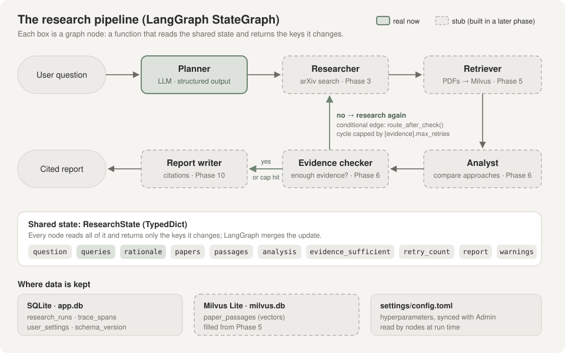

<details>
<summary>Mermaid version (text diagram; renders on GitHub)</summary>

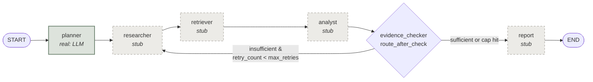

</details>

How to read it:
- **Boxes are nodes.** Each is a Python function `(state, config) -> partial update`.
- **Arrows are edges.** Plain edges always go to the next node. The **diamond**
  (after *Evidence checker*) is a **conditional edge**: not a node but a plain
  function, `route_after_check(state)`, that LangGraph calls after the evidence
  checker finishes. It returns the *name* of the next node: `"researcher"` (the
  "no" branch, back up) or `"report"` (the "yes" branch, left).
- **The arrow back to `researcher` is the cycle.** It's what a plain chain can't do.
  `retry_count` and `max_retries` in the state stop it from looping forever.

### 2. One request end to end

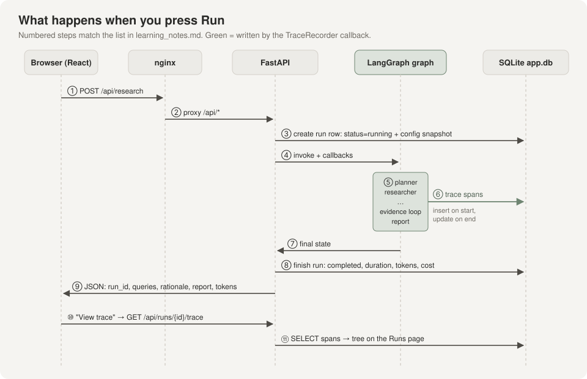

1. The browser sends `POST /api/research {"question": ...}`.
2. nginx (frontend container) forwards every `/api/*` request to the backend container.
3. FastAPI creates the run row in SQLite **first** (`status=running`, config snapshot), so trace spans can point at it.
4. FastAPI calls `graph.invoke(state, config={"callbacks": [TraceRecorder]})`.
5. LangGraph runs the nodes: planner → researcher → retriever → analyst → evidence checker → (loop) → report.
6. While that happens, every node/chain/LLM call fires callbacks; the recorder writes a `trace_spans` row on start and updates it on end.
7. The graph returns the final state to FastAPI.
8. FastAPI finishes the run row: status, duration, total tokens, estimated cost.
9. The browser gets the JSON (plan, report, tokens, run id).
10. "View trace" loads `GET /api/runs/{id}/trace`.
11. The Runs page groups spans by `parent_span_id` and draws the tree.

### 3. How the state grows as it flows through the nodes

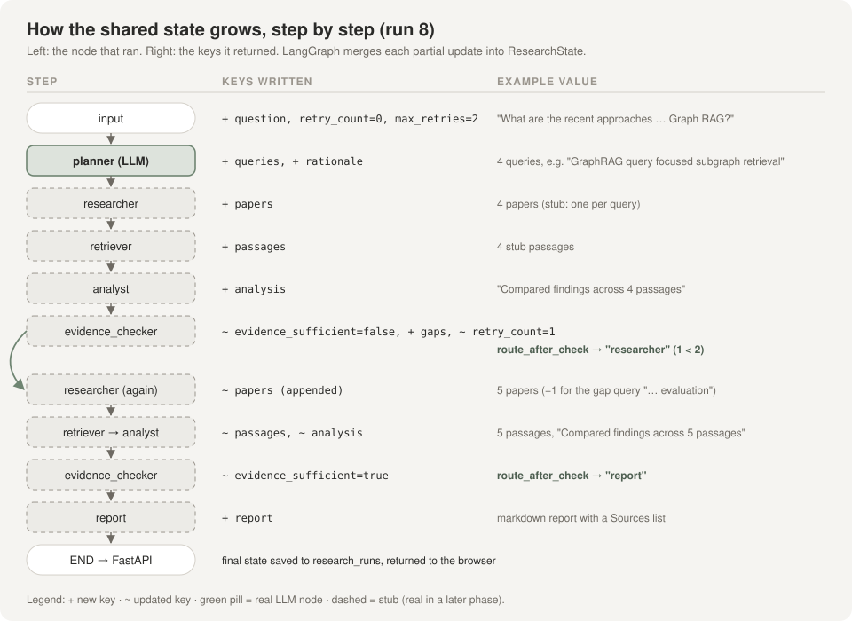

The same steps as a table:

| After node | Keys written (✚ new, ✎ updated) | Example values (run 8) |
|------------|----------------------------------|------------------------|
| *input* | ✚ `question`, `retry_count=0`, `max_retries=2` | "What are the recent approaches…" |
| planner | ✚ `queries`, ✚ `rationale` (✚ `warnings` on failure) | 4 queries, e.g. "GraphRAG query focused subgraph retrieval" |
| researcher | ✚/✎ `papers` (appends on each loop) | stub: one fake paper per query |
| retriever | ✚/✎ `passages` | stub passages |
| analyst | ✚/✎ `analysis` | "[stub] Compared findings across 4 passages." |
| evidence_checker | ✎ `evidence_sufficient`, `evidence_gaps`, `retry_count` | 1st pass: insufficient, gaps=["… evaluation"], retry_count=1 |
| researcher (loop) | ✎ `papers` (+ papers for the gap query) | 5 papers |
| … | … | 2nd check: sufficient → route to report |
| report | ✚ `report` | markdown with a Sources list |

A node only returns what it changes; LangGraph merges that into the state and
passes the whole state to the next node. (Phase 4 adds **reducers**, which say
*how* to merge, e.g. append to a list instead of overwriting.)

### 4. Inside one node: the planner's LCEL chain

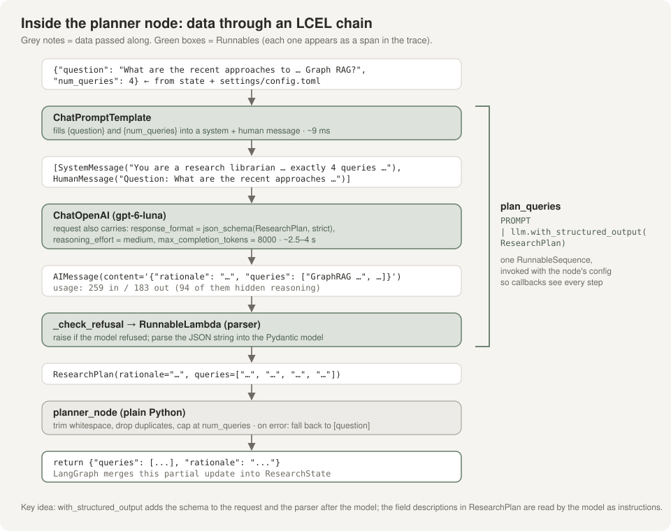

<details>
<summary>Mermaid version (text diagram; renders on GitHub)</summary>

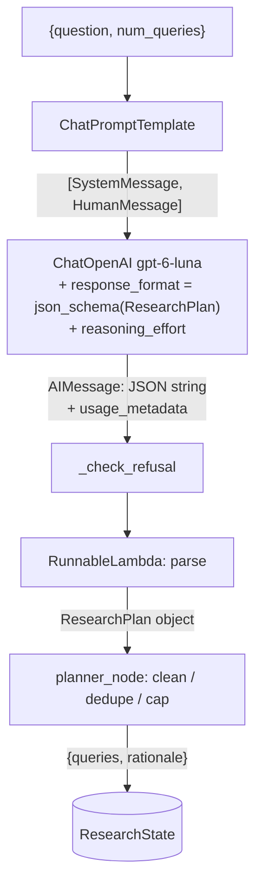

</details>

### 5. How tracing works: one handler, every nested call

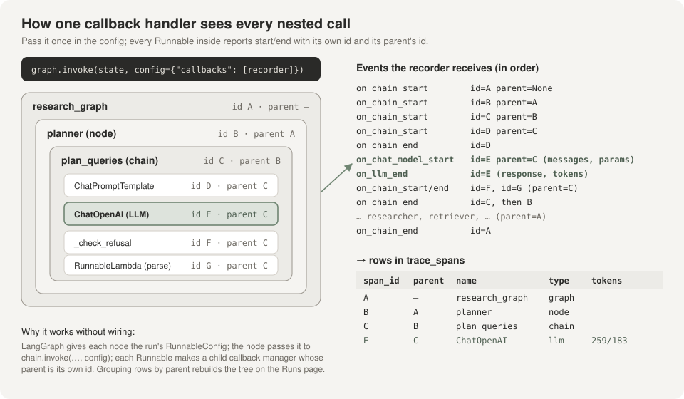

<details>
<summary>Mermaid version (text diagram; renders on GitHub)</summary>

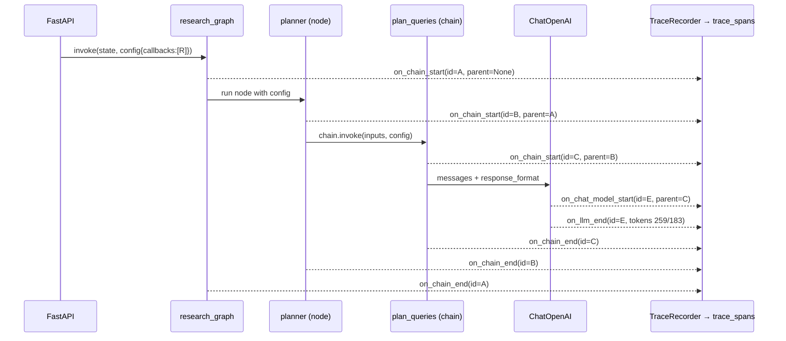

</details>

### 6. Configuration: one file, two editors, read at run time

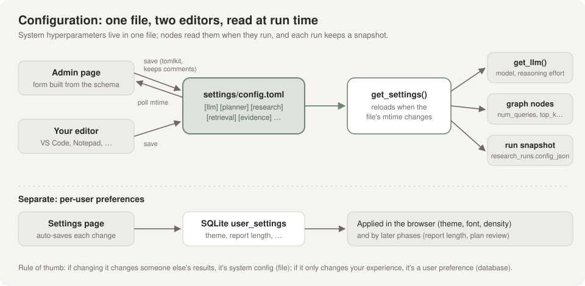

<details>
<summary>Mermaid version (text diagram; renders on GitHub)</summary>

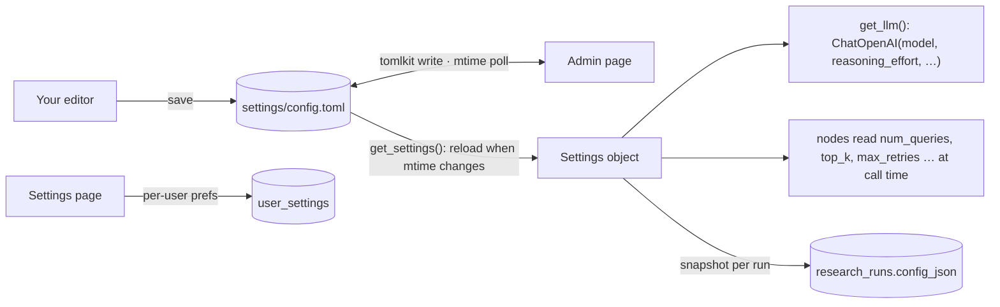

</details>

Why it matters: because nodes read settings **when they run**, a change on the
Admin page applies to the very next run, and every run stores the exact
settings it used, so experiments can be compared later.

---

## Phase 1: UI shell + config sync (no LangGraph)

**Idea:** describe settings once (Pydantic models with metadata) and generate
the form, the validation and the file format from that one description.

- The backend sends `{sections: [{fields: [{type, min, max, description, ...}]}]}`;
  the UI renders whatever it receives, so a new `Field` in `config.py` appears
  on the Admin page with no frontend change. (Proven in Phase 2: `[pricing]`,
  `[tracing]`, `model_kind` and `reasoning_effort` appeared without touching the Admin page.)
- System settings (`config.toml`, Admin) vs user preferences (SQLite, Settings).
- Live sync: mtime-checked hot reload; mount the *directory* because single-file
  bind mounts go stale when an editor saves by replacing the file.

### Workflow walkthrough (Phase 1)

**Outcome in one sentence:** the app got its shell (sidebar, Home, Settings,
Admin) and a control panel, so every later experiment is "change a value on the
Admin page, press Run, compare". The LangGraph graph itself didn't change in this phase.

**Pieces at work**

| Piece | File | What it does |
|-------|------|--------------|
| Settings models | `backend/config.py` | One Pydantic class per `[section]` of `config.toml`; each field has a description, min/max and a label |
| Form describer | `backend/form_schema.py` | Turns those classes into `{sections: [{fields: [...]}]}` for the UI |
| Admin API | `backend/routers/admin.py` | `GET` = read the file + schema; `PUT` = validate, write with tomlkit, reload |
| Hot reload | `get_settings()` in `config.py` | Re-reads the file when its modified-time changes |
| Admin page | `frontend/src/pages/Admin.tsx` | Draws the form from the schema; polls every 4 s for outside edits |
| Settings page | `frontend/src/pages/Settings.tsx` | Per-user preferences, saved to SQLite `user_settings` |

**What happens when you change "Number of queries" from 4 to 6 on the Admin page and press Save**
1. The page sends `PUT /api/admin/config {"changes": {"planner": {"num_queries": 6}}}`.
2. The backend validates it against `PlannerConfig` (`ge=1, le=10`). 6 is fine; 60 would come back as a field error.
3. `tomlkit` writes `num_queries = 6` into `settings/config.toml`, keeping your comments.
4. `force_reload()` refreshes the cached settings.
5. On the **next run**, the planner calls `get_settings().planner.num_queries` and gets 6.
6. That run's row stores the snapshot, so the Runs page shows "6 queries" for it.

Editing the file in VS Code instead works the same way from step 4: the file's
modified-time changes, so the next `get_settings()` call reloads it, and the Admin
page picks it up on its next 4-second poll.


### Think about

**Which settings belong to the system, and which to the user?**
Anything that changes *how the agent works* or what it costs is system config:
models, token limits, retrieval depth, retry caps, prices. Those affect every
user and every result, so they live in one reviewed file (`config.toml`) that's
in git. Anything that only changes *your experience* is a user preference:
theme, report length, whether to review the plan. Two people could pick
differently without affecting each other, so those live per user in the
database. A useful test: "if I change this, does someone else's result change?"
If yes, it's system config.

**Which changes are safe while live, and which need a restart or a data reset?**
- *Safe live:* anything read at call time, such as temperature/effort, top-k,
  number of queries, retry cap. The next run just uses the new value.
- *Restart:* anything read once at startup, such as CORS origins, storage file
  names, the Milvus metric (only applies when a collection is created).
- *Data reset:* anything baked into stored data, especially the embedding model
  and dimension. Old vectors were made by the old model and can't be compared
  with new ones, so the collection must be rebuilt. That's why those fields carry
  a "danger" note and ask for confirmation.

---

## Phase 2: LangChain fundamentals + our own tracing

**Built:** a real planner (`ChatPromptTemplate | ChatOpenAI.with_structured_output(ResearchPlan)`),
a `TraceRecorder` callback handler that records every step into `trace_spans`,
and the Runs page with a trace tree.

### Workflow walkthrough (Phase 2)

**Outcome in one sentence:** one real LLM-powered node (the planner), wired into
a working LangGraph loop, with every step recorded and viewable on the Runs page.
The other nodes are still stubs that return fake data, and the evidence checker
forces one retry on purpose so you can see the loop.

#### 1. The pipeline as a graph


- **Boxes = nodes** (Python functions). Only **Planner** is real so far (green).
- **Plain arrows = edges.** "After this node, always go there."
- **The diamond = a conditional edge.** Not a node: a small function LangGraph
  calls *after* the evidence checker to pick the next node by name:

```python
# backend/graph/workflow.py
def route_after_check(state: ResearchState) -> str:
    if state.get("evidence_sufficient"):
        return "report"                     # "yes" -> left, to Report writer
    if state.get("retry_count", 0) >= state.get("max_retries", 2):
        return "report"                     # cap hit -> report anyway
    return "researcher"                     # "no" -> loop back up

g.add_conditional_edges("evidence_checker", route_after_check,
                        {"researcher": "researcher", "report": "report"})
```

In run 8: the first check said "insufficient" (stub), `retry_count` became 1,
`1 < 2` → **researcher** again; the second check said "sufficient" → **report**.

#### 2. What a node looks like in code

A node is a plain function: **(current state, run config) → dict of only the keys it changes.**

```python
# backend/agents/planner.py (abridged)
PLANNER_PROMPT = ChatPromptTemplate.from_messages([
    ("system", "You are a research librarian … exactly {num_queries} queries …"),
    ("human",  "Question: {question}"),
])

def planner_node(state: ResearchState, config: RunnableConfig) -> dict:
    n = get_settings().planner.num_queries                    # read live from config.toml
    chain = PLANNER_PROMPT | get_llm().with_structured_output(ResearchPlan)
    try:
        plan = chain.invoke({"question": state["question"], "num_queries": n}, config)
        return {"queries": _clean(plan.queries, n), "rationale": plan.rationale}
    except Exception as exc:                                  # LLM failed -> degrade, don't crash
        return {"queries": [state["question"]],
                "warnings": [f"Planner failed ({type(exc).__name__}); used the question."]}
```

And how nodes are registered and connected:

```python
g = StateGraph(ResearchState)              # the state "shape" every node shares
g.add_node("planner", planner_node)        # name -> function
g.add_edge(START, "planner")               # plain edge
g.add_edge("planner", "researcher")
...
graph = g.compile()                        # now a Runnable: graph.invoke(state, config)
```

#### 3. What one node triggers when it runs

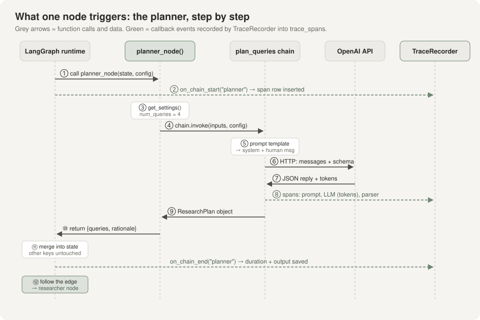

1. **LangGraph calls** `planner_node(state, config)` with the whole current state
   (`question = "What are the recent approaches … Graph RAG?"`, `retry_count = 0`, …).
2. **Callback:** `on_chain_start` fires; TraceRecorder inserts a "planner" row in `trace_spans`.
3. **Settings:** `get_settings()` reads `num_queries = 4` (reloading `config.toml` if it changed).
4. **The chain runs** with the same `config`, so its steps are traced too:
5. `ChatPromptTemplate` fills in the system + human messages (about 9 ms).
6. `ChatOpenAI` makes the **HTTP call to OpenAI**: the messages, `response_format` =
   the JSON schema of `ResearchPlan`, and `reasoning_effort = "medium"`.
7. OpenAI replies with a JSON string plus token usage (e.g. 259 in / 183 out, of which 94 reasoning).
8. Each of those steps sends its own start/end events; the recorder saves spans for
   the prompt, the LLM call (with tokens) and the two parser steps.
9. The parser turns the JSON into a `ResearchPlan` object.
10. The node cleans the queries and **returns** `{"queries": [...], "rationale": "..."}`.
11. **LangGraph merges** that into the state (other keys untouched); `on_chain_end`
    saves the span's duration and output.
12. **LangGraph follows the edge** out of `planner`: a plain edge, so → `researcher`.

You can see all of this for any run: **Runs → click a run → Trace → click `ChatOpenAI`**.

#### 4. The pieces at work in the backend

| Piece | File | Role at runtime |
|-------|------|-----------------|
| **Planner node** (the only real LLM node) | `agents/planner.py` | Question → 2–6 focused arXiv queries + rationale (`gpt-6-luna`) |
| **Structured-output schema** | `models.py` → `ResearchPlan` | Becomes the JSON schema the model must follow; field descriptions act as instructions |
| **LLM factory** | `llm.py` → `get_llm()` | Builds `ChatOpenAI` from config: `reasoning_effort` for reasoning models, `temperature` only for standard ones |
| **Graph + router** | `graph/workflow.py` | Nodes, edges and the diamond (`route_after_check`) |
| **Shared state** | `graph/state.py` → `ResearchState` | The dict every node reads and updates |
| **TraceRecorder** | `tracing/recorder.py` | Callback handler: every node/chain/LLM call → `trace_spans` |
| **Run lifecycle** | `routers/runs.py` | Create run row → `graph.invoke(..., config={"callbacks": [recorder]})` → save status, duration, tokens, cost |
| **Migrations** | `db/sqlite.py` | Version 2 added the run metadata columns and `trace_spans` |
| **APIs** | `routers/runs.py` | `POST /api/research`, `GET /api/runs`, `/api/runs/{id}`, `/api/runs/{id}/trace` |

#### 5. The whole run, end to end


### Concepts in one line each
- **Runnable:** the one interface everything shares: `invoke` (one input),
  `batch` (many), `stream` (pieces as they're produced), plus `ainvoke` and friends.
  A prompt template, a model, a parser and a whole compiled graph are all Runnables.
- **LCEL `|`:** `a | b` builds a `RunnableSequence`: the output of `a` becomes the
  input of `b`. The sequence is itself a Runnable (in our trace: `plan_queries`).
- **ChatPromptTemplate:** a Runnable that turns `{"question": ..., "num_queries": 4}`
  into a list of messages (system + human). In the trace it takes about 9 ms and you
  can see the exact rendered prompt.
- **`with_structured_output(Model)`:** returns a new Runnable that asks the API for
  JSON matching the model's schema and parses the reply into a `ResearchPlan` object.
- **RunnableConfig:** the dict passed alongside the input (`callbacks`, `tags`,
  `metadata`, `run_name`, `recursion_limit`). It flows down to every nested call.
- **Callbacks:** objects with hooks such as `on_chain_start/end/error`,
  `on_chat_model_start`, `on_llm_end`, `on_tool_*`. Every Runnable fires them.

### Think about

**A graph node is just a function and a chain is just a Runnable, so what does the graph add?**
A chain is a fixed pipe: data flows one way, step to step, and each step only
sees the previous step's output. The graph adds:
1. **Shared state:** every node reads the whole `ResearchState` and returns only
   the keys it changes; LangGraph merges them. The planner writes `queries` and
   `rationale`; the report node reads `analysis` and `papers` written by others.
2. **Branching on runtime data:** `route_after_check` looks at the state and
   decides the next node.
3. **Cycles:** our trace shows `researcher → retriever → analyst → evidence_checker`
   **twice**. A plain chain can't loop back.
4. Later phases add more: persistence (Phase 7), pausing for a human (8),
   per-node streaming (9).

**When is a chain enough?** When the work is a straight line with no decisions
or loops. The planner on its own *is* a chain: prompt → model → parser. Use a
graph when steps depend on intermediate results, need to loop, or need shared
memory. Use a chain inside a node when the step itself is linear.

**How do callbacks reach nested calls without passing them down by hand?**
We pass the handler once: `graph.invoke(state, config={"callbacks": [recorder]})`.
Then:
1. LangGraph hands each node the run's `RunnableConfig` (that's why
   `planner_node(state, config)` has a `config` parameter).
2. The node passes it on: `chain.invoke(inputs, config)`.
3. Each Runnable, when it starts, creates a *child* callback manager whose parent
   is its own `run_id`. So every event carries `run_id` and `parent_run_id`.
4. Recent LangChain versions also store the current config in a Python
   **context variable**, so nested calls inherit it even if you forget step 2.

Recording `(run_id, parent_run_id)` for each event rebuilds the tree we see:
`research_graph → planner → plan_queries → ChatPromptTemplate / ChatOpenAI /
_check_refusal / RunnableLambda`. This is exactly how hosted tracers work. They
are a callback handler plus a database plus a UI, which is what we built.

One detail: LangGraph also runs internal "plumbing" Runnables (channel writes
and similar) tagged `langsmith:hidden`. Our recorder skips them and re-attaches
their children to the nearest visible parent, so the tree stays readable.

**What does `with_structured_output` actually send to the model?**
Open the LLM span → "Request parameters". You'll see:
```json
"response_format": {"type": "json_schema",
  "json_schema": {"name": "ResearchPlan", "strict": true,
                  "schema": {"properties": {"rationale": {...}, "queries": {...}}, ...}}}
```
So the Pydantic model is converted to a JSON Schema and sent as OpenAI's
`response_format`. With `strict`, the API **constrains generation** so the
reply must match the schema. The reply arrives as a JSON string in the message
content (visible in the span's Response), and the two extra steps after the
model in the trace do the parsing:
- `_check_refusal`: raises if the model refused instead of answering;
- `RunnableLambda`: parses the JSON into a `ResearchPlan` object.

Takeaways: the **field descriptions are part of the prompt** (the model reads the
schema), so write them as instructions. The schema also costs input tokens: the
planner call uses about 260 input tokens, of which the system prompt is only part.
Other options are `method="function_calling"` (sent as a tool) and `json_mode`
(valid JSON, no schema guarantee).

### Experiments (same question, `gpt-6-luna`)

| Run | Setting | Queries | Total time | LLM time | Tokens (in+out) | Reasoning tokens |
|-----|---------|---------|-----------:|---------:|----------------:|-----------------:|
| 7 | effort **low** | 4 | 4.38 s | 2.87 s | 407 | 56 |
| 6 | effort **medium** | 4 | 5.43 s | 3.99 s | 442 | 94 |
| 8 | effort **high** | 4 | 4.40 s | 3.99 s | 580 | 231 |
| 9 | num_queries **2** (medium) | 2 | 2.88 s | 2.42 s | 392 | 64 |
| 10 | num_queries **6** (medium) | 6 | 3.20 s | 2.81 s | 430 | 60 |
| 11 | model `no-such-model` | 1 (fallback) | 0.63 s | 0.35 s | 0 | 0 |

**What we learned:**
- **Reasoning effort controls hidden thinking.** Reasoning tokens went 56 → 94 → 231
  from low to high (about 4×), and they're billed as output tokens even though you
  never see them. The visible answer stayed the same size.
- **Higher effort gave more specific queries.** Low: "multi-hop graph retrieval
  reranking GraphRAG", "adaptive query expansion…". High: "GraphRAG query focused
  subgraph retrieval", "GraphRAG hybrid vector graph reranking": narrower,
  closer to real paper titles. Whether that finds *better papers* is something
  Phase 3 can check.
- **More queries cost almost nothing here.** 2 vs 6 queries changed total tokens by
  only about 40, because the output is tiny compared with the prompt + schema +
  reasoning. Cost is driven by *input size* and *reasoning*, not by how many items you ask for.
- **Latency is noisy.** Single runs vary by a second or more (network, server
  load), e.g. medium took longer than high. Compare averages of several runs before
  drawing conclusions about speed.
- **Failures degrade instead of crashing.** With a bad model name OpenAI returned
  404 (not retried, since it isn't transient). The planner fell back to the raw
  question, the run still completed, and the warning appeared on Home and in the
  trace (the LLM span is marked `error`). The trade-off is that a degraded run looks
  "completed", so warnings must be visible, which they are.

### Things worth remembering
- A node that calls an LLM should accept `config` and pass it to `.invoke()`.
- Name your chains (`.with_config(run_name="plan_queries")`); the names are what you
  see when debugging.
- Reasoning models: no `temperature`; `reasoning_effort` instead; leave
  `max_tokens` headroom because reasoning counts towards it.

---

## Phase 3: Tools and tool calling
_(to fill in: concepts, workflow walkthrough, experiments, answers)_
