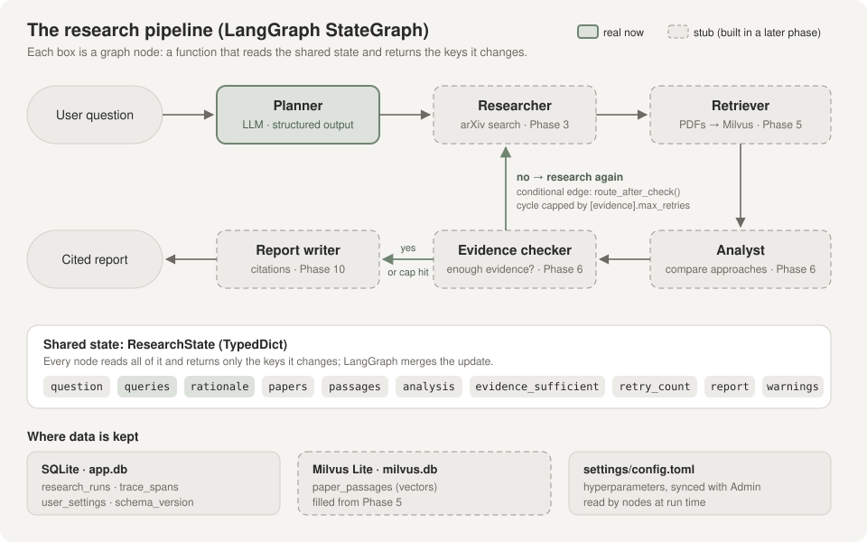
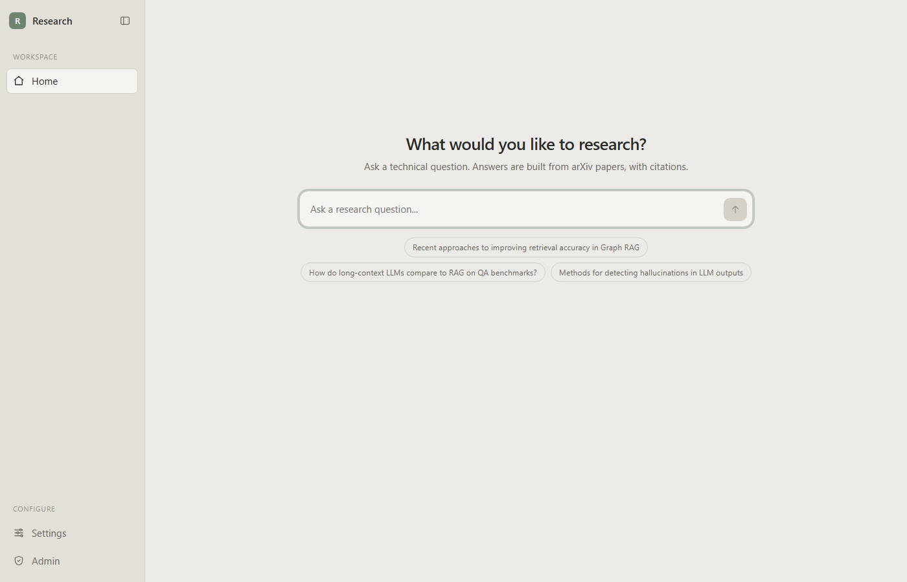
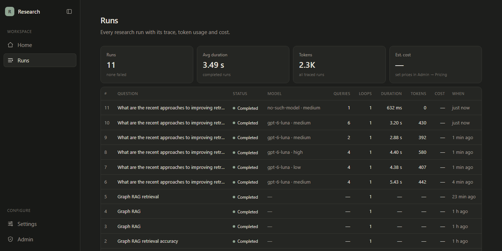
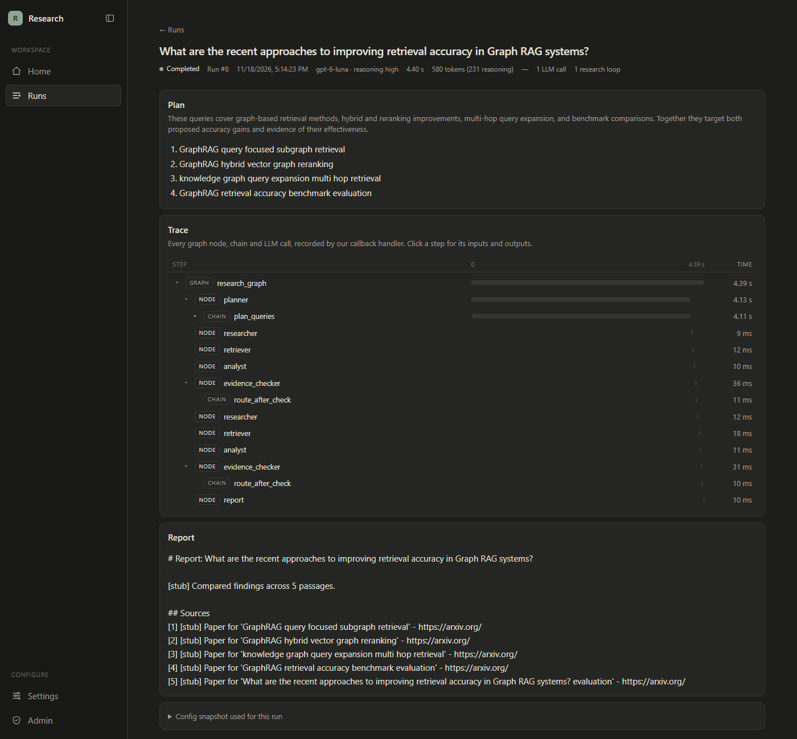
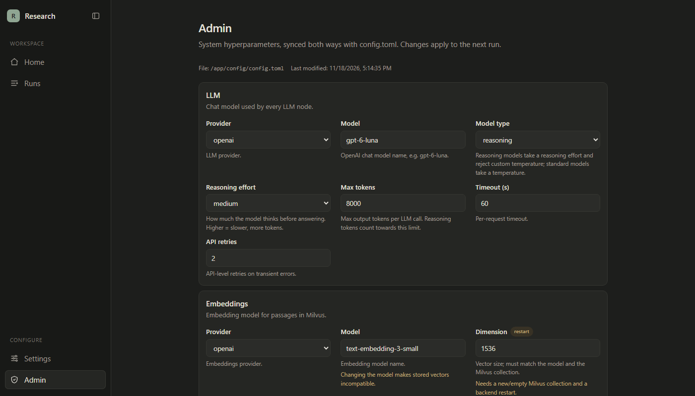
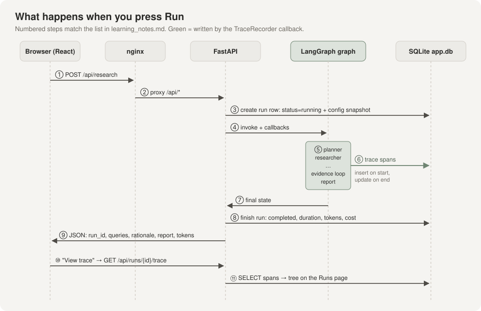
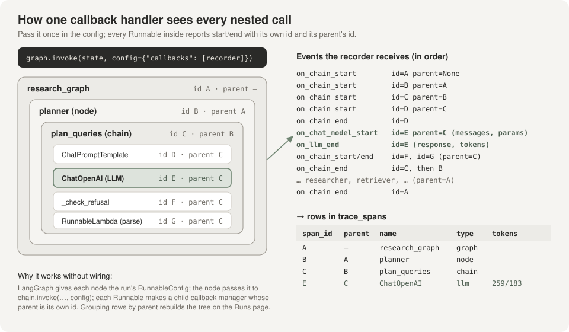

# Agentic Research Assistant

A research assistant built with **LangGraph** and **LangChain** that answers technical
questions **from papers rather than from model memory**. It plans search queries,
finds papers on arXiv, reads them, compares approaches, checks whether each claim is
backed by a retrieved passage (and **loops back to research when evidence is weak**),
then writes a cited report.

The project is also a structured way to **learn LangGraph and LangChain in depth**.
It's built in phases, and each phase introduces a new part of the framework.
Notes, diagrams and experiment results are in [`MD_files/learning_notes.md`](MD_files/learning_notes.md).

> **Status:** Phase 2 of 11 complete. The planner (LLM), our own tracing and the full UI
> work end to end; the research, retrieval, analysis and report nodes are still stubs that
> keep the graph runnable. See the [roadmap](#roadmap).



---

## Features (working today)

- **LangGraph workflow:** a `StateGraph` with shared state, a conditional edge and a
  **bounded research loop** (`planner → researcher → retriever → analyst → evidence checker → (loop | report)`).
- **LLM planner:** `ChatPromptTemplate | ChatOpenAI.with_structured_output(ResearchPlan)` turns
  a question into focused arXiv queries plus a rationale, and falls back gracefully on errors.
- **Built-in tracing and analytics (no external service):** a LangChain callback handler
  records every graph node, chain and LLM call (prompts, responses, tokens incl. reasoning
  tokens, latency, request parameters) into SQLite. The **Runs** page shows history, stats
  and an expandable trace tree with timing bars.
- **Live configuration:** every hyperparameter is in `settings/config.toml`, **two-way
  synced** with the **Admin** page (edit either one; changes apply to the next run without a
  restart). Each run stores a snapshot of the settings it used, so experiments can be compared.
- **User settings:** theme (matte light/dark), font size, density and research preferences,
  saved per user.
- **One-command deployment:** FastAPI backend + React/TypeScript frontend, each in its own
  container, run together with `docker compose`.

| Home | Runs | Run trace | Admin |
|------|------|-----------|-------|
|  |  |  |  |

---

## Tech stack

| Layer | Technology |
|-------|------------|
| Agent orchestration | LangGraph (`StateGraph`), LangChain core |
| LLM + embeddings | OpenAI via `langchain-openai` (default `gpt-6-luna`, a reasoning model; `text-embedding-3-small`) |
| Research source | arXiv API (free, no key) |
| Vector store | Milvus Lite (embedded, file-based) |
| App database | SQLite (runs, trace spans, user settings) |
| Backend | Python 3.12, FastAPI, Pydantic / pydantic-settings |
| Frontend | React 18 + TypeScript + Vite, served by nginx |
| Deployment | Docker + docker compose |

---

## Quick start

**Prerequisites:** Docker (with Compose v2.24+) and an OpenAI API key.

```bash
git clone https://github.com/KSAP02/ResearchAgent.git
cd ResearchAgent
cp .env.example .env          # then set OPENAI_API_KEY in .env
docker compose up -d --build
```

- App: **http://localhost:3000** (Home · Runs · Settings · Admin)
- API docs (Swagger): **http://localhost:8000/docs**
- Health check: `curl localhost:3000/api/health`

Stop with `docker compose down`; wipe all stored data with `docker compose down -v`.

> The backend is meant to run **in Docker only**: Milvus Lite has no Windows build and
> allows one process per database file, so the API runs as a single uvicorn worker.

---

## Configuration

| Where | What | How to change |
|-------|------|---------------|
| `.env` | Secrets and deployment values (`OPENAI_API_KEY`, `CORS_ORIGINS`) | Edit, then `docker compose up -d` |
| `settings/config.toml` | **All hyperparameters**: model and reasoning effort, number of queries, arXiv limits, chunking, top-k, retry cap, pricing, tracing | Edit the file **or** use the **Admin** page; synced both ways, applied live |
| Settings page | Per-user preferences (theme, report length, plan review, …) | Saved automatically |

Any config value can also be overridden from the environment as `SECTION__KEY`,
e.g. `LLM__MODEL=gpt-4.1`. Fields that need a restart or a data reset are labelled on the Admin page.

---

## How it works

### Graph state, routing and retries
All nodes share one `ResearchState` (question, queries, papers, passages, analysis,
evidence verdict, retry count, report, …). Each node returns only the keys it changes,
and LangGraph merges them. After the analyst, the **evidence checker** decides through a
conditional edge whether the evidence is sufficient. If it isn't, the graph **routes back
to the researcher** with the gaps as new queries. The loop is capped by
`[evidence].max_retries`, and the report says when evidence stayed weak instead of
inventing citations.

### A request, end to end


### Tracing without an external service
LangChain fires callback events for every Runnable (graph, node, chain, LLM, tool), each
carrying its own `run_id` and its parent's id. One handler passed in
`graph.invoke(..., config={"callbacks": [TraceRecorder]})` records them all into
`trace_spans`, and the Runs page rebuilds the tree.



---

## Project structure

```text
ResearchAgent/
├── backend/
│   ├── app.py                 # FastAPI entry point
│   ├── config.py              # settings: .env > settings/config.toml > defaults (hot reload)
│   ├── llm.py                 # get_llm() / get_embeddings() factories
│   ├── models.py              # structured-output schemas (ResearchPlan, …)
│   ├── agents/                # graph nodes: planner, researcher, analyst, fact_checker, reporter
│   ├── tools/                 # arXiv search, PDF extraction, vector retrieval
│   ├── graph/                 # state.py (ResearchState), workflow.py (StateGraph + routing)
│   ├── tracing/recorder.py    # TraceRecorder callback handler
│   ├── db/                    # SQLite (migrations, runs, spans, settings), Milvus Lite
│   └── routers/               # /api/runs, /api/admin, /api/user
├── frontend/                  # React + TypeScript (pages: Home, Runs, Settings, Admin)
├── settings/config.toml       # all hyperparameters (synced with the Admin page)
├── MD_files/                  # build plan, database design, phase records, learning notes, diagrams
├── docker-compose.yml
├── requirements.txt           # Python deps (backend image + local venv)
└── .env.example
```

---

## Roadmap

Each phase adds a working feature **and** teaches a part of the framework.
Full plan: [`MD_files/build_plan.md`](MD_files/build_plan.md).

| Phase | Builds | Framework concepts | Status |
|-------|--------|--------------------|--------|
| 0 | Scaffold, stub graph, Docker | `StateGraph`, nodes, conditional edges, cycles | ✅ |
| 1 | UI shell, Admin config sync, user settings | Config as data | ✅ |
| 2 | LLM planner, own tracing, Runs page | Runnables, LCEL, prompts, structured output, callbacks | ✅ |
| 3 | arXiv researcher as a tool-calling agent | `@tool`, `bind_tools`, `ToolNode`, ReAct loop | ⏳ next |
| 4 | Parallel search per query | Reducers, input/output schemas, `Send` (map-reduce) | |
| 5 | PDF ingestion + retrieval | Loaders, splitters, embeddings, vector store, retrievers | |
| 6 | Analyst + evidence loop | `Command`, subgraphs, LLM judges | |
| 7 | Run history with replay | Checkpointers, threads, time travel | |
| 8 | Approve the plan before research | `interrupt()`, human-in-the-loop | |
| 9 | Live progress in the UI | Streaming modes, custom events | |
| 10 | Cited report + evaluation | Structured reports, evaluation harness | |
| 11 | Same problem, three paradigms | Functional API vs prebuilt agents vs graphs | |

---

## Documentation

| Document | Contents |
|----------|----------|
| [`MD_files/build_plan.md`](MD_files/build_plan.md) | Goals, outcomes and all phases with done-criteria |
| [`MD_files/learning_notes.md`](MD_files/learning_notes.md) | Visual guide + per-phase concepts, experiments and answers |
| [`MD_files/database.md`](MD_files/database.md) | Every table and collection, schema, live vs planned |
| [`MD_files/build_phases/`](MD_files/build_phases/) | Record of each finished phase |
| [`project_scaffold.md`](project_scaffold.md) | Reusable recipe for scaffolding a LangGraph agent as a service |
| [`CLAUDE.md`](CLAUDE.md) | Working rules, architecture and changelog |

---

## Data sources and costs

- **arXiv API and PDFs:** free, official API, no key; requests are rate-limited (~1 per 3 s)
  as arXiv asks. No scraping.
- **OpenAI:** paid per token (LLM + embeddings). Token usage per run is shown on the Runs
  page; enter your model's prices under Admin → Pricing to see estimated cost.
- Papers keep their own licences: text is stored as chunks for personal research and quoted
  with citations, never republished.

---

## Running on another machine

Verified with a fresh clone: the images build, the database is created on first start, and every page loads.

1. Install **Docker Desktop** (includes Docker Compose; v2.24 or newer is required).
2. Clone the repo and create your `.env`:
   ```bash
   git clone https://github.com/KSAP02/ResearchAgent.git
   cd ResearchAgent
   cp .env.example .env          # Windows PowerShell: copy .env.example .env
   ```
3. Open `.env` and set your key. It's the only required value:
   ```env
   OPENAI_API_KEY=sk-...
   ```
4. Build and start:
   ```bash
   docker compose up -d --build
   ```
5. Open **http://localhost:3000** (API docs at http://localhost:8000/docs).

**Good to know**
- **Data stays on the machine that created it.** Runs, traces and user settings live in a
  Docker volume (`research_data`), not in git, so a new machine starts with an empty Runs page.
  Hyperparameters in `settings/config.toml` *are* in git and come along.
- **Model access:** the default model (`gpt-6-luna`) must be available to your OpenAI account.
  If it isn't, change `[llm].model` on the Admin page (or in `settings/config.toml`).
- **Without a key** the app still runs: the planner falls back to your question and shows a warning.
- Useful commands:
  ```bash
  docker compose logs -f backend      # backend logs
  docker compose restart backend      # after changing .env or a "restart" setting
  docker compose down                 # stop (keeps data)
  docker compose down -v              # stop and delete all stored data
  ```

---

## Making changes: commit and push

Work on one machine at a time and keep both in sync through GitHub.

```bash
# 1. Start from the latest version
git pull origin main

# 2. Make your changes, then rebuild and check them in Docker
docker compose up -d --build
curl localhost:3000/api/health

# 3. Review what changed (make sure .env is NOT listed; it's git-ignored)
git status
git diff

# 4. Commit with a message that says what and why
git add -A
git commit -m "Short summary of the change"

# 5. Push to GitHub
git push origin main
```

**Tips**
- Always `git pull` before starting on a different machine, so the two copies don't drift apart.
- Never commit `.env` or anything under `data_warehouse/`. Both are in `.gitignore`;
  `git status` should never show them.
- Changes made on the **Admin** page are written to `settings/config.toml`, so they show up
  in `git status` too. Commit them if you want the new settings on other machines.
- If `git push` is rejected because GitHub has newer commits, run `git pull origin main`,
  resolve any conflicts, then push again.
